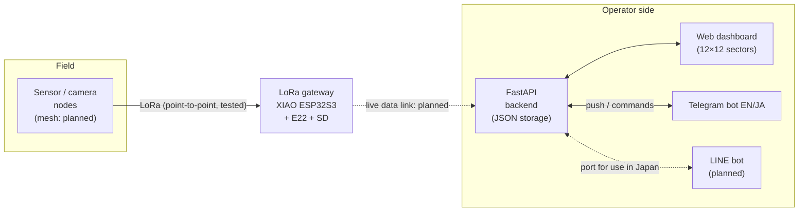
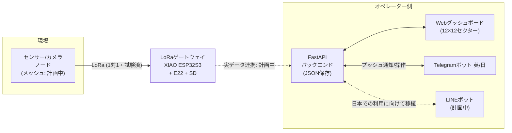
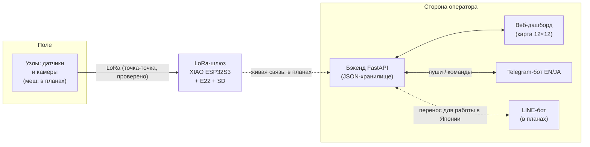

# TerraNode

**Low-power LoRa environmental telemetry for places where the network doesn't reach.**


🇬🇧 [English](#english) · 🇯🇵 [日本語](#日本語) · 🇷🇺 [Русский](#русский)

---

## English

### Why TerraNode

Ecologists today mostly rely on two approaches: satellite imagery / GIS (wide, but coarse and infrequent) or on-foot field surveys (detailed, but slow and labour-intensive). TerraNode aims at the gap between them: small, cheap, low-power nodes that keep observing a site and pass data on hop by hop, **without needing cellular coverage or a nearby server**.

Classic CCTV needs LTE and local infrastructure, whereas LoRa runs in licence-exempt spectrum, so a small network can in principle be deployed on a slope, in a forest or in a reserve within a day or two, without negotiating coverage with a telecom operator.

### What's in this repository

TerraNode has two halves that are developed together and will eventually meet in the middle:

| Part | What it does | Details |
|---|---|---|
| **Hardware / firmware** | LoRa gateway on a Seeed XIAO ESP32S3 + Ebyte E22-900T22D: receives packets, logs RSSI, tracks packet delivery ratio (PDR), writes to microSD | [`hardware/`](hardware) · [README](hardware/README_en.md) |
| **Dashboard** | FastAPI backend and live web map with a 12×12 sector grid; node and gateway management; eco-anomaly reports | [`software/dashboard/`](software/dashboard) · [README](software/dashboard/README_en.md) |
| **Telegram bot** | Bilingual (EN/JA) bot for field operators: observations, anomaly reports with photo/GPS, node status, check-in | [`software/telegram_bot/`](software/telegram_bot) · [README](software/telegram_bot/README_en.md) |

Setup and run instructions live in each part's own README; this page is the overview.

### Architecture

Solid arrows are implemented and tested; dashed arrows are planned.



### Project status

This is an early-stage, independently built prototype. Every component is labelled honestly:

- **Built & tested**: implemented and verified on the bench or in the field
- **Prototype**: exists, but not integrated or not validated
- **Conceptual**: designed or planned, not implemented

| Component | Status | Notes |
|---|---|---|
| LoRa point-to-point UART link (XIAO ESP32S3 + E22-900T22D ↔ E22-900T22D on a PC via USB-TTL) | **Built & tested** | Bench tested; field tested in Losiny Ostrov forest park (Moscow): two-way packets delivered up to ~500 m over mixed open/wooded terrain |
| Per-packet RSSI logging | **Built & tested** | RSSI-byte option enabled in the module via config mode |
| Packet Delivery Ratio (PDR) tracking | **Built & tested** | Sequential packet numbers, PC-side beacon script |
| microSD logging | **Built & tested** | Session-numbered files, timestamps relative to boot |
| Dashboard, REST backend, Telegram bot | **Built & tested (locally)** | Run together on a PC, operating on **manually entered** node data |
| Live gateway → dashboard data flow | **Prototype / next step** | Dashboard currently shows manual/mock data, not real sensor state |
| Onboard camera capture and image transmission | **Prototype** | Hardware present (XIAO ESP32S3 Sense); capture pipeline not integrated |
| Multi-node LoRa mesh | **Conceptual** | Only a single point-to-point link so far |
| Solar / battery autonomy | **Conceptual** | Power consumption not yet measured |
| RTC / GPS | **Conceptual** | Not onboard; log time is relative to boot only |
| LINE version of the field-operator bot | **Conceptual** | Planned for use in Japan (see roadmap) |
| Long-range, durability and power testing | **Not yet done** | Only one ~500 m field test so far; a systematic RSSI-vs-distance and PDR-vs-distance dataset is in progress |

### Features

**Hardware / firmware**
- Reads incoming LoRa packets over UART and parses the appended RSSI byte
- Tracks PDR from sequential packet numbers
- Logs everything to microSD; LED heartbeat / receive indication
- A PC-side beacon script sends numbered test packets at a fixed interval for controlled range testing

**Dashboard and bot**
- 12×12 sector grid, identical in the dashboard, backend and bot (a coordinate always maps to the same sector)
- Add / edit / move / delete nodes and the gateway with a click-to-pick mini-map
- Eco-anomaly reports (species, severity, GPS, notes, photo/video) from the dashboard or Telegram
- Anomaly lifecycle: **Reported → Investigating → Resolved**
- Real-time two-way sync between dashboard and Telegram
- Every bot message is shown as **English / 日本語**

### Repository layout

```
terranode/
├── hardware/                  # LoRa gateway firmware (PlatformIO)
│   ├── src/
│   │   └── main.cpp                     # gateway firmware
│   ├── utils/
│   │   └── enable_rssi_config_e22.cpp   # one-time RSSI-byte setup sketch
│   ├── tools/
│   │   └── tx_beacon.py                 # PC-side numbered-packet test beacon
│   ├── platformio.ini
│   ├── README_en.md
│   └── README_ja.md
├── software/
│   ├── dashboard/             # FastAPI backend + web dashboard
│   ├── telegram_bot/          # bilingual Telegram bot
│   ├── README_en.md
│   └── README_ja.md
├── LICENSE
└── README.md
```

### Hardware

- Seeed Studio XIAO ESP32S3 (Sense variant: camera + microSD slot)
- 2× Ebyte E22-900T22D LoRa modules (868 MHz band)
- USB-to-TTL adapter (CP2102) for the PC-side test node

### Roadmap

1. Connect live gateway output to the dashboard, so it shows real node state
2. Complete the systematic RSSI-vs-distance and PDR-vs-distance dataset; measure power consumption
3. Camera capture and periodic image transmission
4. Multi-node mesh relay
5. Solar charging and battery autonomy tests
6. RTC / GPS for real timestamps and location tagging
7. Port the field-operator bot to LINE (Messaging API) for deployment in Japan, where LINE is the everyday messenger; the Telegram version stays available

### Research context

TerraNode is developed independently as part of ongoing research into practical, low-cost autonomous sensing for remote terrain (forest dynamics, slopes, plant–environment interactions).

### License

MIT License.

### Author

Anton Abramov

---

## 日本語

### TerraNodeとは

生態学の現場では、主に衛星画像・GIS(広域だが粗く更新頻度が低い)と、徒歩による現地調査(詳細だが時間と労力がかかる)の二つが使われています。TerraNodeはその中間を埋めることを目指しています。小型・低コスト・低消費電力のノードが調査地を継続的に観測し、データをホップごとに中継します。**携帯電話の通信圏や近くのサーバーは不要**です。

従来の監視カメラはLTEや現地のインフラを必要としますが、LoRaは免許不要の周波数帯を使うため、通信事業者との調整なしに、斜面・森林・保護区などに小規模なネットワークを1〜2日で展開できる可能性があります。

### このリポジトリの内容

TerraNodeは、並行して開発している二つの部分で構成され、将来的に接続されます。

| 部分 | 内容 | 詳細 |
|---|---|---|
| **ハードウェア / ファームウェア** | Seeed XIAO ESP32S3 + Ebyte E22-900T22D によるLoRaゲートウェイ。パケット受信、RSSI記録、パケット到達率(PDR)の集計、microSDへの保存 | [`hardware/`](hardware) · [README](hardware/README_ja.md) |
| **ダッシュボード** | FastAPIバックエンドと、12×12セクターのライブWebマップ。ノード・ゲートウェイの管理、環境異常の報告 | [`software/dashboard/`](software/dashboard) · [README](software/dashboard/README_ja.md) |
| **Telegramボット** | 現場オペレーター向けの二言語(英/日)ボット。観察記録、写真・GPS付き異常報告、ノード状態の確認、チェックイン | [`software/telegram_bot/`](software/telegram_bot) · [README](software/telegram_bot/README_ja.md) |

セットアップと実行方法は各部分のREADMEに記載しています。このページは全体の概要です。

### アーキテクチャ

実線は実装・テスト済み、点線は計画中です。



### 開発状況

個人で開発している初期段階のプロトタイプです。各要素の状況を誇張なく区別して記載します。

- **実装・実テスト済み**:実装し、ベンチまたは野外で動作を確認済み
- **プロトタイプ**:存在するが、統合または検証が未完了
- **構想段階**:設計・計画のみで未実装

| 要素 | 状況 | 備考 |
|---|---|---|
| LoRa 1対1 UART通信(XIAO ESP32S3 + E22-900T22D ↔ USB-TTL経由でPCに接続したE22-900T22D) | **実装・実テスト済み** | ベンチテストに加え、モスクワのロシーヌイ・オストロフ森林公園で、開けた場所と樹木が混在する地形において約500mまで双方向のパケット到達を確認 |
| パケットごとのRSSI記録 | **実装・実テスト済み** | 設定モードでモジュールのRSSIバイト出力を有効化 |
| パケット到達率(PDR)の集計 | **実装・実テスト済み** | 連番パケットとPC側ビーコンスクリプトによる |
| microSDへのログ記録 | **実装・実テスト済み** | 起動セッション番号付き、時刻は起動からの相対時間 |
| ダッシュボード、RESTバックエンド、Telegramボット | **実装・ローカルで動作確認済み** | PC上で連携動作。ただし**手動入力**のノードデータで動作 |
| ゲートウェイ → ダッシュボードの実データ連携 | **プロトタイプ / 次のステップ** | 現状は手動・モックデータで、実際のセンサー状態ではない |
| 内蔵カメラでの撮影・画像送信 | **プロトタイプ** | ハードウェア(XIAO ESP32S3 Sense)は搭載済み、撮影パイプライン未統合 |
| 複数ノードのLoRaメッシュ | **構想段階** | 現時点では1対1通信のみ |
| ソーラー/バッテリーによる自律稼働 | **構想段階** | 消費電力は未測定 |
| RTC / GPS | **構想段階** | 未搭載のため、ログ時刻は起動からの相対時間のみ |
| 現場オペレーター向けLINE版ボット | **構想段階** | 日本での利用を想定(今後の計画を参照) |
| 長距離・耐久性・消費電力の試験 | **未実施** | 実地試験は約500mの1回のみ。距離とRSSI/PDRの体系的なデータ収集を進行中 |

### 主な機能

**ハードウェア / ファームウェア**
- UARTで受信したLoRaパケットを解析し、付加されたRSSIバイトを取得
- 連番パケットからPDRを算出
- すべてmicroSDに記録。LEDでハートビート/受信を表示
- PC側のビーコンスクリプトが一定間隔で連番テストパケットを送信し、通信距離を制御された条件で測定

**ダッシュボードとボット**
- 12×12セクターグリッド(ダッシュボード・バックエンド・ボットで同一。座標は常に同じセクターに対応)
- ミニマップのクリック操作で、ノードとゲートウェイの追加・編集・移動・削除
- ダッシュボードまたはTelegramから環境異常を報告(対象種、脅威レベル、GPS、メモ、写真/動画)
- 異常のステータス管理:**報告済み → 調査中 → 解決済み**
- ダッシュボードとTelegramの双方向リアルタイム同期
- ボットの全メッセージを **English / 日本語** で表示

### リポジトリ構成

```
terranode/
├── hardware/                  # LoRaゲートウェイのファームウェア(PlatformIO)
│   ├── src/
│   │   └── main.cpp                     # ゲートウェイ本体のファームウェア
│   ├── utils/
│   │   └── enable_rssi_config_e22.cpp   # RSSIバイト出力を有効化する初回設定用スケッチ
│   ├── tools/
│   │   └── tx_beacon.py                 # PC側の連番パケット送信テストビーコン
│   ├── platformio.ini
│   ├── README_en.md
│   └── README_ja.md
├── software/
│   ├── dashboard/             # FastAPIバックエンド + Webダッシュボード
│   ├── telegram_bot/          # 二言語対応Telegramボット
│   ├── README_en.md
│   └── README_ja.md
├── LICENSE
└── README.md
```

### 使用ハードウェア

- Seeed Studio XIAO ESP32S3(Senseバリアント:カメラ・microSDスロット内蔵)
- Ebyte E22-900T22D LoRaモジュール ×2(868MHz帯)
- USB-TTL変換アダプタ(CP2102、PC側テストノード用)

### 今後の計画

1. ゲートウェイの実データをダッシュボードに接続し、実際のノード状態を表示
2. 距離とRSSI/PDRの体系的なデータ収集を完了し、消費電力を測定
3. カメラ撮影と定期的な画像送信
4. 複数ノードによるメッシュ中継
5. ソーラー充電とバッテリー自律稼働の試験
6. RTC/GPSによる実時刻と位置情報の記録
7. 現場オペレーター向けボットのLINE(Messaging API)版への移植。日本ではLINEが日常的なメッセンジャーであるため、日本での運用を想定。Telegram版も引き続き利用可能

### 研究の背景

TerraNodeは、遠隔地(森林動態、斜面、植物と環境の相互作用など)における、低コストで実用的な自律センシングに関する個人研究の一環として開発しています。

### ライセンス

MITライセンス

### 作者

トニー・アブラモヴ (Anton Abramov)

---

## Русский

### Зачем нужен TerraNode

Экологи сегодня в основном пользуются двумя подходами: спутниковые снимки и ГИС (охват широкий, но детализация низкая и обновляется редко) или пешие полевые обследования (детально, но медленно и трудозатратно). TerraNode нацелен на промежуток между ними: небольшие дешёвые энергоэффективные узлы, которые постоянно наблюдают за участком и передают данные от узла к узлу, **без сотовой связи и без сервера поблизости**.

Обычному видеонаблюдению нужны LTE и местная инфраструктура, а LoRa работает в безлицензионном диапазоне. Поэтому небольшую сеть в принципе можно развернуть на склоне, в лесу или в заповеднике за день-два, не договариваясь с оператором связи о покрытии.

### Что в репозитории

TerraNode состоит из двух частей, которые развиваются параллельно и в перспективе будут соединены:

| Часть | Что делает | Подробнее |
|---|---|---|
| **Железо / прошивка** | LoRa-шлюз на Seeed XIAO ESP32S3 + Ebyte E22-900T22D: принимает пакеты, пишет RSSI, считает долю доставленных пакетов (PDR), сохраняет на microSD | [`hardware/`](hardware) · [README (EN)](hardware/README_en.md) |
| **Дашборд** | Бэкенд на FastAPI и живая веб-карта с сеткой секторов 12×12; управление узлами и шлюзом; отчёты об экологических аномалиях | [`software/dashboard/`](software/dashboard) · [README (EN)](software/dashboard/README_en.md) |
| **Telegram-бот** | Двуязычный (EN/JA) бот для полевых операторов: наблюдения, отчёты об аномалиях с фото и GPS, статус узлов, отметка о прибытии | [`software/telegram_bot/`](software/telegram_bot) · [README (EN)](software/telegram_bot/README_en.md) |

Инструкции по установке и запуску лежат в README каждой части (на английском и японском); эта страница даёт общий обзор.

### Архитектура

Сплошные стрелки означают «реализовано и проверено», пунктирные «в планах».



### Статус проекта

Это ранний прототип, который я делаю самостоятельно. Каждый компонент описан честно:

- **Сделано и проверено**: реализовано и подтверждено на столе или в поле
- **Прототип**: существует, но не интегрировано или не проверено
- **Концепция**: спроектировано или запланировано, не реализовано

| Компонент | Статус | Примечания |
|---|---|---|
| LoRa-канал точка-точка по UART (XIAO ESP32S3 + E22-900T22D ↔ E22-900T22D на ПК через USB-TTL) | **Сделано и проверено** | Стендовые тесты, а также полевой тест в лесопарке «Лосиный остров» (Москва): двусторонняя доставка пакетов до ~500 м на смешанной местности (открытые участки и лес) |
| Запись RSSI по каждому пакету | **Сделано и проверено** | Опция вывода байта RSSI включена в модуле через режим конфигурации |
| Подсчёт доли доставленных пакетов (PDR) | **Сделано и проверено** | По сквозной нумерации пакетов, скрипт-маяк на стороне ПК |
| Логирование на microSD | **Сделано и проверено** | Файлы с номером сессии, время относительно старта |
| Дашборд, REST-бэкенд, Telegram-бот | **Сделано, проверено локально** | Работают вместе на ПК, но на **вручную введённых** данных узлов |
| Живой поток данных шлюз → дашборд | **Прототип / следующий шаг** | Сейчас дашборд показывает ручные/тестовые данные, а не реальное состояние датчиков |
| Съёмка встроенной камерой и передача кадров | **Прототип** | Железо есть (XIAO ESP32S3 Sense), пайплайн съёмки не интегрирован |
| LoRa-меш из нескольких узлов | **Концепция** | Пока только один канал точка-точка |
| Автономность от солнца и аккумулятора | **Концепция** | Энергопотребление ещё не измерено |
| RTC / GPS | **Концепция** | Нет на борту, время в логах только относительно старта |
| LINE-версия бота для полевых операторов | **Концепция** | Запланирована для работы в Японии (см. планы) |
| Тесты дальности, долговечности и энергопотребления | **Ещё не сделано** | Пока один полевой тест на ~500 м; идёт сбор систематических данных «RSSI от расстояния» и «PDR от расстояния» |

### Возможности

**Железо / прошивка**
- Принимает LoRa-пакеты по UART, разбирает добавленный байт RSSI
- Считает PDR по сквозной нумерации пакетов
- Пишет всё на microSD; светодиод показывает работу и приём
- Скрипт-маяк на стороне ПК отправляет нумерованные тестовые пакеты с фиксированным интервалом для контролируемых тестов дальности

**Дашборд и бот**
- Сетка секторов 12×12, одинаковая в дашборде, бэкенде и боте (координата всегда попадает в один и тот же сектор)
- Добавление, правка, перемещение и удаление узлов и шлюза кликом по мини-карте
- Отчёты об экологических аномалиях (вид, угроза, GPS, заметки, фото/видео) из дашборда или Telegram
- Жизненный цикл аномалии: **Сообщено → Расследуется → Решено**
- Двусторонняя синхронизация дашборда и Telegram в реальном времени
- Все сообщения бота выводятся как **English / 日本語**

### Структура репозитория

```
terranode/
├── hardware/                  # прошивка LoRa-шлюза (PlatformIO)
│   ├── src/
│   │   └── main.cpp                     # прошивка шлюза
│   ├── utils/
│   │   └── enable_rssi_config_e22.cpp   # разовый скетч включения байта RSSI
│   ├── tools/
│   │   └── tx_beacon.py                 # тестовый маяк с нумерованными пакетами (ПК)
│   ├── platformio.ini
│   ├── README_en.md
│   └── README_ja.md
├── software/
│   ├── dashboard/             # бэкенд FastAPI + веб-дашборд
│   ├── telegram_bot/          # двуязычный Telegram-бот
│   ├── README_en.md
│   └── README_ja.md
├── LICENSE
└── README.md
```

### Оборудование

- Seeed Studio XIAO ESP32S3 (вариант Sense: камера и слот microSD)
- 2× LoRa-модуля Ebyte E22-900T22D (диапазон 868 МГц)
- USB-TTL адаптер (CP2102) для тестового узла на стороне ПК

### Планы

1. Подключить живые данные шлюза к дашборду, чтобы он показывал реальное состояние узлов
2. Завершить систематический набор данных «RSSI/PDR от расстояния», измерить энергопотребление
3. Съёмка камерой и периодическая передача изображений
4. Ретрансляция в меш-сети из нескольких узлов
5. Тесты солнечной зарядки и автономной работы от аккумулятора
6. RTC / GPS для реального времени и привязки к местности
7. Перенос бота для полевых операторов в LINE (Messaging API) для работы в Японии, где LINE является повседневным мессенджером; версия для Telegram остаётся доступной

### Исследовательский контекст

TerraNode разрабатывается самостоятельно в рамках исследования практичных недорогих автономных систем мониторинга для удалённой местности (динамика леса, склоны, взаимодействие растений и среды).

### Лицензия

MIT License.

### Автор

Антон Абрамов (Anton Abramov)
