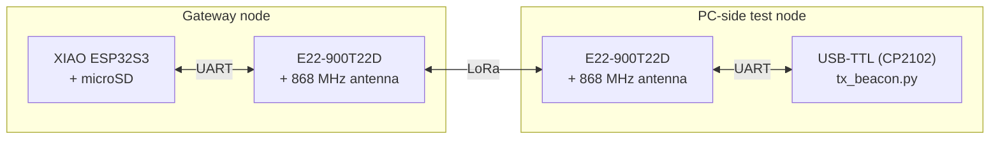
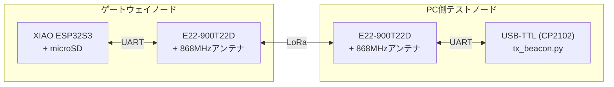
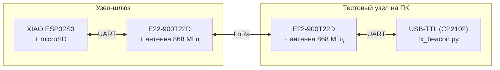

# TerraNode: Hardware

**A low-power LoRa gateway node for environmental monitoring in places without network coverage.**


🇬🇧 [English](#english) · 🇯🇵 [日本語](#日本語) · 🇷🇺 [Русский](#русский)

⬅️ [Project overview](../README.md) · 💻 [Software](../software/README.md)

---

## English

### Overview

The hardware and firmware side of TerraNode: a LoRa gateway node built on a Seeed XIAO ESP32S3 and an Ebyte E22-900T22D module. It receives packets over a LoRa link, logs signal strength (RSSI) and packet delivery ratio (PDR) to a microSD card, and is the future data source for the [dashboard and bot](../software/README.md).

> **Status: early prototype.** The point-to-point link is built and field-tested. Mesh, camera, solar power and live dashboard integration are not implemented yet (see [Status](#status)).

### Hardware inventory

| Component | Qty | Notes |
|---|---|---|
| **Microcontroller:** Seeed Studio XIAO ESP32S3 (Sense variant) | 1 | Onboard camera connector and microSD slot |
| **Transceiver:** Ebyte E22-900T22D | 2 | Based on the Semtech SX1262 LoRa core; used at 868 MHz |
| **Antenna:** 868 MHz LoRa | 2 | One per module |
| **Prototyping:** breadboards and jumper wires | 2 boards | For bench wiring |
| **USB-to-TTL adapter (CP2102)** | 1 | Connects the PC-side test module |
| **microSD card** | 1 | Data logging on the gateway |

### Test setup



The PC-side node sends numbered test packets; the gateway logs them with RSSI and computes PDR from the packet numbers.

### Development and testing environment

- **Firmware IDE:** Visual Studio Code with PlatformIO
- **Serial debugging and monitoring:** PuTTY

### Status

- **Built & tested**: verified on the bench or in the field
- **Prototype**: exists, but not integrated or not validated
- **Conceptual**: designed or planned, not implemented

| Component | Status | Notes |
|---|---|---|
| LoRa point-to-point UART link | **Built & tested** | Bench tested; field tested in Pokrovskoye-Streshnevo forest park (Moscow), up to ~150 m over mixed open/wooded terrain |
| microSD logging | **Built & tested** | Session-numbered files, timestamps relative to boot |
| Per-packet RSSI logging | **Built & tested** | RSSI-byte option enabled in the module via config mode |
| Packet Delivery Ratio (PDR) tracking | **Built & tested** | Sequential packet numbers |
| Onboard camera capture | **Prototype** | Hardware present; capture pipeline not integrated |
| Multi-node mesh | **Conceptual** | Single point-to-point link only |
| Solar / battery autonomous power | **Conceptual** | Power consumption not yet measured |
| Weather and soil sensors | **Conceptual** | Planned for field deployment |
| RTC / GPS | **Conceptual** | Not onboard; log time is relative to boot only |
| Dashboard integration | **Prototype** | The dashboard runs on manually entered data; live gateway data is not connected yet |

### Repository contents

```
hardware/
├── src/
│   └── main.cpp                     # gateway firmware
├── utils/
│   └── enable_rssi_config_e22.cpp   # one-time RSSI-byte setup sketch
├── tools/
│   └── tx_beacon.py                 # PC-side numbered-packet test beacon
├── platformio.ini
└── README.md
```

- `main.cpp` reads incoming LoRa packets over UART, parses the appended RSSI byte, tracks PDR from sequential packet numbers, logs everything to microSD, and gives LED heartbeat / receive feedback.
- `enable_rssi_config_e22.cpp` is a one-time sketch that enables the module's RSSI-byte output; the setting is stored in the module's own flash memory.
- `tx_beacon.py` sends numbered test packets at a fixed interval through the USB-TTL–connected module, for controlled range and PDR tests.

### Quick start

```bash
cd hardware
pio run -t upload                  # build and flash the gateway firmware
```

Run the RSSI setup sketch once per module before first use (it is a separate PlatformIO environment, see `platformio.ini`). For range tests, set the serial port and interval at the top of `tools/tx_beacon.py` and run it on the PC.

### Field test summary

Initial range test in Pokrovskoye-Streshnevo forest park (Moscow): two-way communication confirmed up to approximately 150 m across a mix of open ground and forest cover. A systematic RSSI-vs-distance and PDR-vs-distance dataset is in progress.

### Power and deployment notes

- **Current phase:** bench testing and RF validation, including a first field range test.
- **Next phase:** integrating an autonomous solar power supply and weather / soil sensors for field deployment under forest canopy.

### Roadmap

1. Connect live gateway output to the dashboard
2. Complete the RSSI-vs-distance and PDR-vs-distance dataset; measure power consumption
3. Camera capture and periodic image transmission
4. Multi-node mesh relay
5. Solar charging and battery autonomy tests
6. Weather and soil sensors
7. RTC / GPS module for real timestamps and location tagging

### License

MIT License.

---

## 日本語

### 概要

TerraNodeのハードウェア・ファームウェア部分です。Seeed XIAO ESP32S3 と Ebyte E22-900T22D モジュールで作ったLoRaゲートウェイノードで、LoRa経由でパケットを受信し、電波強度(RSSI)とパケット到達率(PDR)をmicroSDカードに記録します。将来的には[ダッシュボードとボット](../software/README.md)へのデータ供給源になります。

> **状況:初期段階のプロトタイプ。** 1対1のLoRa通信は実装・野外テスト済みです。メッシュ、カメラ、ソーラー電源、ダッシュボードとの実データ連携はまだ未実装です([開発状況](#開発状況)を参照)。

### 使用ハードウェア

| 部品 | 数量 | 備考 |
|---|---|---|
| **マイコン:** Seeed Studio XIAO ESP32S3(Senseバリアント) | 1 | カメラコネクタとmicroSDスロットを搭載 |
| **無線モジュール:** Ebyte E22-900T22D | 2 | Semtech SX1262 LoRaコア搭載。868MHzで使用 |
| **アンテナ:** 868MHz LoRa用 | 2 | モジュール1台につき1本 |
| **試作用:** ブレッドボードとジャンパーワイヤー | 2枚 | ベンチでの配線用 |
| **USB-TTL変換アダプタ(CP2102)** | 1 | PC側テストモジュールの接続用 |
| **microSDカード** | 1 | ゲートウェイでのログ記録用 |

### テスト構成



PC側ノードが連番付きテストパケットを送信し、ゲートウェイがRSSIとともに記録して、パケット番号からPDRを算出します。

### 開発・テスト環境

- **ファームウェア開発:** Visual Studio Code + PlatformIO
- **シリアルデバッグ・モニタリング:** PuTTY

### 開発状況

- **実装・実テスト済み**:ベンチまたは野外で動作を確認済み
- **プロトタイプ**:存在するが、統合または検証が未完了
- **構想段階**:設計・計画のみで未実装

| 要素 | 状況 | 備考 |
|---|---|---|
| LoRa 1対1 UART通信 | **実装・実テスト済み** | ベンチテストに加え、モスクワのポクロフスコエ・ストレシュネヴォ公園で、開けた場所と樹木が混在する地形において約150mまで確認 |
| microSDへのログ記録 | **実装・実テスト済み** | 起動セッション番号付き、時刻は起動からの相対時間 |
| パケットごとのRSSI記録 | **実装・実テスト済み** | 設定モードでモジュールのRSSIバイト出力を有効化 |
| パケット到達率(PDR)の集計 | **実装・実テスト済み** | 連番パケットによる |
| 内蔵カメラでの撮影 | **プロトタイプ** | ハードウェアは搭載済み、撮影パイプライン未統合 |
| 複数ノードのメッシュ | **構想段階** | 1対1通信のみ |
| ソーラー/バッテリーによる自律電源 | **構想段階** | 消費電力は未測定 |
| 気象・土壌センサー | **構想段階** | 野外展開に向けて計画中 |
| RTC / GPS | **構想段階** | 未搭載のため、ログ時刻は起動からの相対時間のみ |
| ダッシュボード連携 | **プロトタイプ** | ダッシュボードは手動入力データで動作。ゲートウェイの実データとは未接続 |

### リポジトリの内容

```
hardware/
├── src/
│   └── main.cpp                     # ゲートウェイ本体のファームウェア
├── utils/
│   └── enable_rssi_config_e22.cpp   # RSSIバイト出力を有効化する初回設定用スケッチ
├── tools/
│   └── tx_beacon.py                 # PC側の連番パケット送信テストビーコン
├── platformio.ini
└── README.md
```

- `main.cpp`:UARTで受信したLoRaパケットを解析し、付加されたRSSIバイトを読み取り、連番パケットからPDRを算出し、すべてをmicroSDに記録。LEDでハートビート/受信を表示します。
- `enable_rssi_config_e22.cpp`:モジュールのRSSIバイト出力を有効化するための一度きりのスケッチ。設定はモジュール自体のフラッシュメモリに保存されます。
- `tx_beacon.py`:USB-TTL接続されたモジュールを通じて一定間隔で連番テストパケットを送信し、通信距離とPDRを制御された条件で測定します。

### クイックスタート

```bash
cd hardware
pio run -t upload                  # ゲートウェイのファームウェアをビルドして書き込み
```

初回のみ、各モジュールでRSSI設定スケッチを実行してください(`platformio.ini` 内の別環境になっています)。通信距離テストでは、`tools/tx_beacon.py` の冒頭でシリアルポートと送信間隔を設定し、PC上で実行します。

### 実地テストの概要

モスクワのポクロフスコエ・ストレシュネヴォ公園での初期の通信距離テストで、開けた場所と森林の混在する地形において、約150mまでの双方向通信を確認しました。距離とRSSI/PDRの体系的なデータ収集を進めています。

### 電源・展開に関するメモ

- **現在のフェーズ:** ベンチテストとRF検証(最初の野外通信距離テストを含む)。
- **次のフェーズ:** 森林の樹冠下での野外展開に向けた、自律型ソーラー電源と気象・土壌センサーの統合。

### 今後の計画

1. ゲートウェイの実データをダッシュボードに接続
2. 距離とRSSI/PDRのデータ収集を完了し、消費電力を測定
3. カメラ撮影と定期的な画像送信
4. 複数ノードによるメッシュ中継
5. ソーラー充電とバッテリー自律稼働の試験
6. 気象・土壌センサー
7. RTC/GPSモジュールによる実時刻と位置情報の記録

### ライセンス

MITライセンス

---

## Русский

### Обзор

Аппаратная часть и прошивка TerraNode: LoRa-шлюз на Seeed XIAO ESP32S3 и модуле Ebyte E22-900T22D. Он принимает пакеты по LoRa, записывает уровень сигнала (RSSI) и долю доставленных пакетов (PDR) на microSD и в будущем станет источником данных для [дашборда и бота](../software/README.md).

> **Статус: ранний прототип.** Канал точка-точка сделан и проверен в поле. Меш, камера, солнечное питание и подключение живых данных к дашборду пока не реализованы (см. [Статус](#статус)).

### Состав оборудования

| Компонент | Кол-во | Примечания |
|---|---|---|
| **Микроконтроллер:** Seeed Studio XIAO ESP32S3 (вариант Sense) | 1 | Разъём камеры и слот microSD на борту |
| **Трансиверы:** Ebyte E22-900T22D | 2 | На ядре Semtech SX1262; используются на 868 МГц |
| **Антенны:** LoRa 868 МГц | 2 | По одной на модуль |
| **Макетирование:** макетные платы и провода | 2 платы | Для стендовой сборки |
| **USB-TTL адаптер (CP2102)** | 1 | Подключение тестового модуля на стороне ПК |
| **Карта microSD** | 1 | Запись логов на шлюзе |

### Тестовый стенд



Узел на ПК отправляет нумерованные тестовые пакеты, а шлюз записывает их вместе с RSSI и считает PDR по номерам пакетов.

### Среда разработки и тестирования

- **IDE для прошивки:** Visual Studio Code с PlatformIO
- **Отладка и мониторинг последовательного порта:** PuTTY

### Статус

- **Сделано и проверено**: подтверждено на столе или в поле
- **Прототип**: существует, но не интегрировано или не проверено
- **Концепция**: спроектировано или запланировано, не реализовано

| Компонент | Статус | Примечания |
|---|---|---|
| LoRa-канал точка-точка по UART | **Сделано и проверено** | Стендовые тесты; полевой тест в лесопарке «Покровское-Стрешнево» (Москва), до ~150 м на смешанной местности (открытые участки и лес) |
| Логирование на microSD | **Сделано и проверено** | Файлы с номером сессии, время относительно старта |
| Запись RSSI по каждому пакету | **Сделано и проверено** | Опция вывода байта RSSI включена в модуле через режим конфигурации |
| Подсчёт доли доставленных пакетов (PDR) | **Сделано и проверено** | По сквозной нумерации пакетов |
| Съёмка встроенной камерой | **Прототип** | Железо есть, пайплайн съёмки не интегрирован |
| Меш из нескольких узлов | **Концепция** | Пока только один канал точка-точка |
| Автономное питание от солнца и аккумулятора | **Концепция** | Энергопотребление ещё не измерено |
| Метео- и почвенные датчики | **Концепция** | Планируются для полевой установки |
| RTC / GPS | **Концепция** | Нет на борту, время в логах только относительно старта |
| Интеграция с дашбордом | **Прототип** | Дашборд работает на вручную введённых данных; живые данные шлюза пока не подключены |

### Содержимое репозитория

```
hardware/
├── src/
│   └── main.cpp                     # прошивка шлюза
├── utils/
│   └── enable_rssi_config_e22.cpp   # разовый скетч включения байта RSSI
├── tools/
│   └── tx_beacon.py                 # тестовый маяк с нумерованными пакетами (ПК)
├── platformio.ini
└── README.md
```

- `main.cpp` принимает LoRa-пакеты по UART, разбирает добавленный байт RSSI, считает PDR по нумерации пакетов, пишет всё на microSD и показывает светодиодом работу и приём.
- `enable_rssi_config_e22.cpp` разовый скетч, включающий вывод байта RSSI в модуле; настройка хранится во флеш-памяти самого модуля.
- `tx_beacon.py` отправляет нумерованные тестовые пакеты с фиксированным интервалом через модуль, подключённый по USB-TTL, для контролируемых тестов дальности и PDR.

### Быстрый старт

```bash
cd hardware
pio run -t upload                  # сборка и прошивка шлюза
```

Один раз перед первым использованием запустите на каждом модуле скетч настройки RSSI (это отдельное окружение PlatformIO, см. `platformio.ini`). Для тестов дальности задай порт и интервал в начале `tools/tx_beacon.py` и запусти его на ПК.

### Итоги полевого теста

Первый тест дальности в лесопарке «Покровское-Стрешнево» (Москва): двусторонняя связь подтверждена примерно до 150 м на смешанной местности (открытые участки и лес). Систематический набор данных «RSSI от расстояния» и «PDR от расстояния» собирается.

### Заметки по питанию и развёртыванию

- **Текущий этап:** стендовые испытания и проверка радиоканала, включая первый полевой тест дальности.
- **Следующий этап:** интеграция автономного солнечного питания и метео- и почвенных датчиков для установки в поле под пологом леса.

### Планы

1. Подключить живые данные шлюза к дашборду
2. Завершить набор данных «RSSI/PDR от расстояния», измерить энергопотребление
3. Съёмка камерой и периодическая передача изображений
4. Ретрансляция в меш-сети из нескольких узлов
5. Тесты солнечной зарядки и автономной работы от аккумулятора
6. Метео- и почвенные датчики
7. Модуль RTC / GPS для реального времени и привязки к местности

### Лицензия

MIT License.
