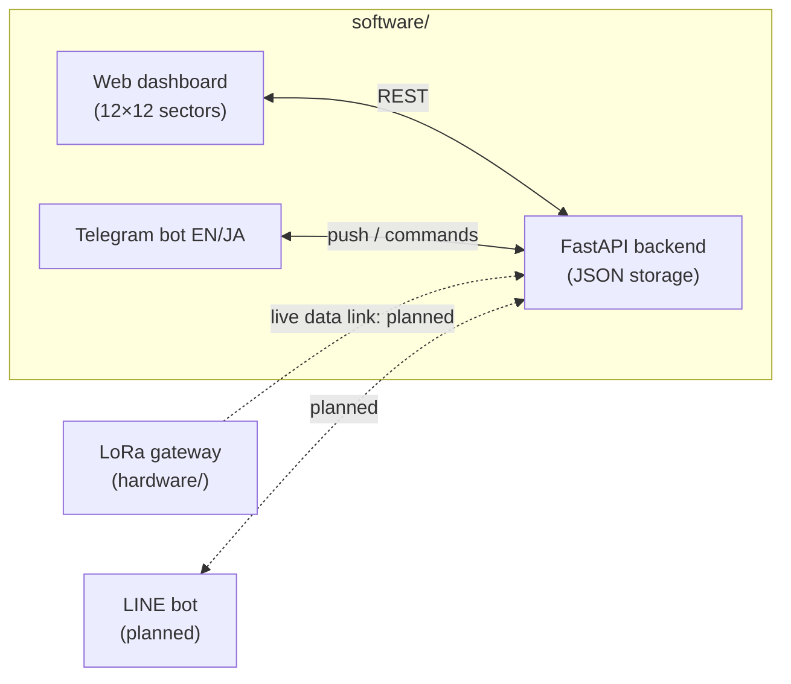
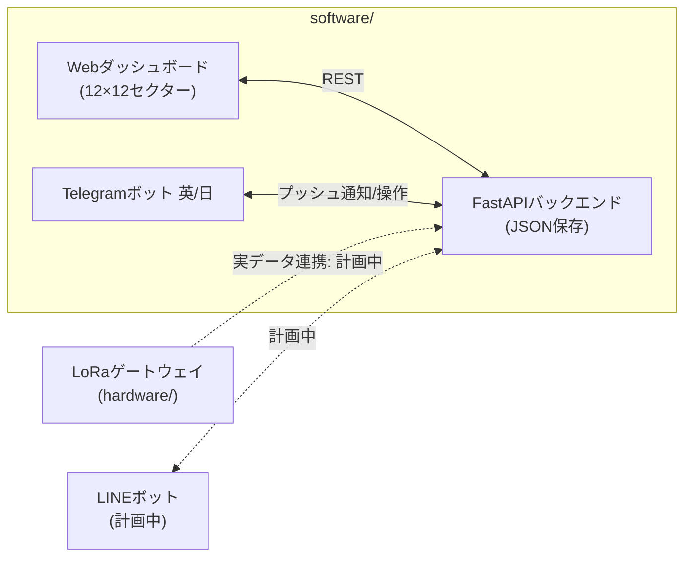
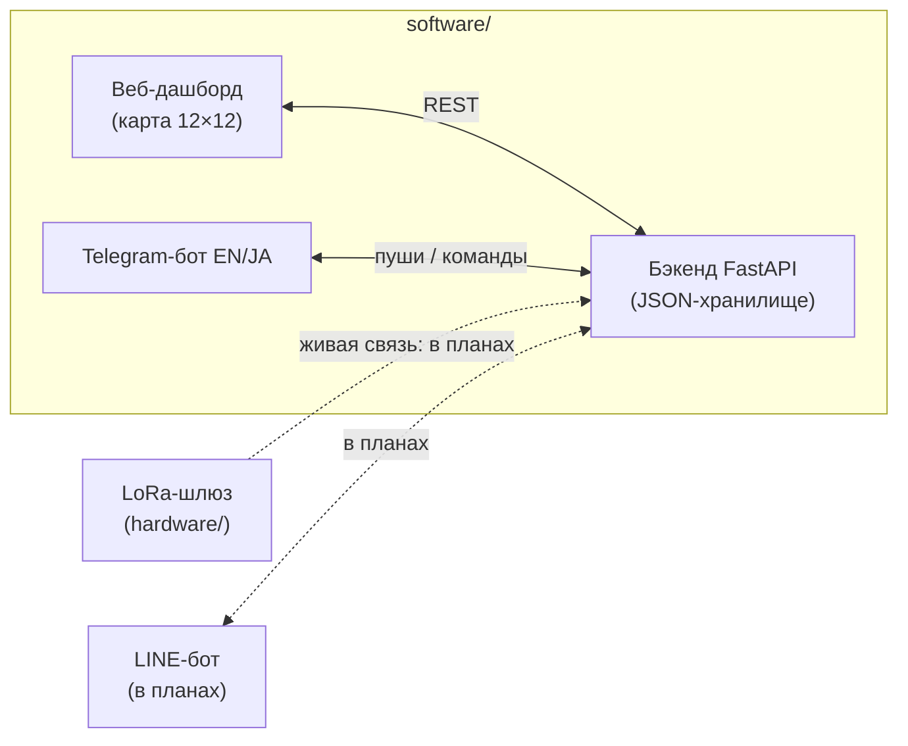

# TerraNode: Software

**Web dashboard and Telegram bot for monitoring a field site from a browser or a phone.**


🇬🇧 [English](#english) · 🇯🇵 [日本語](#日本語) · 🇷🇺 [Русский](#русский)

⬅️ [Project overview](../README.md) · 🔧 [Hardware](../hardware/README_en.md)

---

## English

### Overview

The software side of TerraNode: a web dashboard and a Telegram bot that share one backend, so a field site can be monitored and reported on from a browser or from a phone.

> **Status: prototype.** Everything below runs and has been tested locally. It currently operates on **manually entered** node data; live data from the physical LoRa gateway is not connected yet (see [Status](#status)).

### Components

| Component | What it does | Details |
|---|---|---|
| **Dashboard** ([`dashboard/`](dashboard)) | FastAPI backend with a REST API and a live web map; node and gateway management; eco-anomaly reports | [README](dashboard/README_en.md) |
| **Telegram bot** ([`telegram_bot/`](telegram_bot)) | Bilingual (EN/JA) bot for field operators: observation samples, anomaly reports with photo/video and GPS, node and network status, GPS update, check-in | [README](telegram_bot/README_en.md) |

Install and run instructions for each component are in its own README.

### How the pieces fit together

Solid arrows are implemented; dashed arrows are planned.



- The **backend** is the single source of truth. It stores nodes, the gateway position and anomaly reports in JSON files.
- The **dashboard** and the **bot** are two front ends to the same data. Any change made in one (adding a node, moving the gateway, filing an anomaly) is pushed to the other in real time.
- Both parts must use the **same JSON data files** and the same `.env` values, otherwise they will not see each other's changes.

### Key features

- **One sector grid everywhere.** The map is divided into a 12×12 sector grid implemented identically in the dashboard, backend and bot, so a coordinate always reports the same sector wherever you look.
- **Node and gateway management.** Add, edit, move and delete sensor nodes and the LoRa gateway (router) with a click-to-pick mini-map. The gateway can be reset to its default position.
- **Eco-anomaly reporting** from the dashboard *or* Telegram: species, severity, GPS, notes and an optional photo/video. The bot includes a review-before-submit step.
- **Anomaly lifecycle:** **Reported → Investigating → Resolved**, editable from the dashboard or from Telegram (`/myreports`).
- **Bilingual bot.** Every message is shown as **English / 日本語**.
- **Real-time sync** between dashboard and Telegram in both directions.

### Status

| Component | Status | Notes |
|---|---|---|
| Dashboard, REST backend | **Built & tested (locally)** | Runs on a PC at `http://localhost:8000/dashboard` |
| Telegram bot | **Built & tested (locally)** | Polling mode; requires a bot token |
| Dashboard ↔ bot real-time sync | **Built & tested (locally)** | Both directions |
| Live data from the LoRa gateway / physical nodes | **Prototype / next step** | The dashboard shows manually entered nodes, not real sensor state |
| LINE version of the bot | **Conceptual** | Planned for use in Japan |

### Requirements

- Python 3
- Python packages: `fastapi`, `uvicorn`, `aiogram`, `aiohttp`, `python-dotenv`, `pydantic`
- A Telegram bot token (create one with [@BotFather](https://t.me/BotFather)) and your Telegram chat ID

### Configuration

Create a `.env` file (**never commit this file**):

```
BOT_TOKEN=your_telegram_bot_token
ADMIN_CHAT_ID=your_telegram_chat_id
```

Both components read the same values. Make sure `.env` is listed in `.gitignore`.

### Running

Run the dashboard backend and the bot as two separate processes; exact commands and folders are in each component's README:

- [Dashboard](dashboard/README_en.md)
- [Telegram bot](telegram_bot/README_en.md)

Start the backend first, then the bot.

### License

MIT License. See [LICENSE](../LICENSE).

---

## 日本語

### 概要

TerraNodeのソフトウェア部分です。Webダッシュボードと Telegram ボットが一つのバックエンドを共有しており、ブラウザからでもスマートフォンからでも、調査地の監視と報告ができます。

> **状況:プロトタイプ。** 以下はすべてローカル環境で動作確認済みです。現時点では**手動入力**されたノードデータで動作しており、物理LoRaゲートウェイからの実データはまだ接続されていません([開発状況](#開発状況)を参照)。

### 構成要素

| 要素 | 内容 | 詳細 |
|---|---|---|
| **ダッシュボード**([`dashboard/`](dashboard)) | REST APIを備えたFastAPIバックエンドと、ライブWebマップ。ノード・ゲートウェイの管理、環境異常の報告 | [README](dashboard/README_ja.md) |
| **Telegramボット**([`telegram_bot/`](telegram_bot)) | 現場オペレーター向けの二言語(英/日)ボット。観察サンプルの送信、写真・動画・GPS付きの異常報告、ノード/ネットワーク状態の確認、GPS更新、チェックイン | [README](telegram_bot/README_ja.md) |

インストールと実行方法は、各要素のREADMEに記載しています。

### 全体の仕組み

実線は実装済み、点線は計画中です。



- **バックエンド**がデータの唯一の基準です。ノード、ゲートウェイの位置、異常報告をJSONファイルに保存します。
- **ダッシュボード**と**ボット**は、同じデータへの二つの入り口です。一方での変更(ノード追加、ゲートウェイ移動、異常報告など)は、もう一方へリアルタイムで反映されます。
- 両者は**同じJSONデータファイル**と同じ `.env` の値を使う必要があります。そうでないと、互いの変更が見えません。

### 主な機能

- **どこでも同じセクターグリッド。** 地図は12×12のセクターグリッドに分割されており、ダッシュボード・バックエンド・ボットで同一の実装です。座標はどこで見ても同じセクターとして報告されます。
- **ノードとゲートウェイの管理。** センサーノードとLoRaゲートウェイ(ルーター)の追加・編集・移動・削除を、クリックで位置を選べるミニマップで行います。ゲートウェイは既定位置に戻すこともできます。
- **環境異常の報告**をダッシュボード*または* Telegram から行えます。対象種、脅威レベル、GPS、メモ、任意の写真・動画。ボットには送信前の確認ステップがあります。
- **異常のステータス管理:** **報告済み → 調査中 → 解決済み**。ダッシュボードまたは Telegram(`/myreports`)から編集できます。
- **二言語対応のボット。** すべてのメッセージを **English / 日本語** で表示します。
- ダッシュボードと Telegram の間で、**双方向のリアルタイム同期**を行います。

### 開発状況

| 要素 | 状況 | 備考 |
|---|---|---|
| ダッシュボード、RESTバックエンド | **実装・ローカルで動作確認済み** | PC上の `http://localhost:8000/dashboard` で動作 |
| Telegramボット | **実装・ローカルで動作確認済み** | ポーリング方式。ボットトークンが必要 |
| ダッシュボード ↔ ボットのリアルタイム同期 | **実装・ローカルで動作確認済み** | 双方向 |
| LoRaゲートウェイ/物理ノードからの実データ | **プロトタイプ / 次のステップ** | ダッシュボードは、実際のセンサー状態ではなく手動入力されたノードを表示 |
| ボットのLINE版 | **構想段階** | 日本での利用を想定 |

### 必要環境

- Python 3
- Pythonパッケージ:`fastapi`、`uvicorn`、`aiogram`、`aiohttp`、`python-dotenv`、`pydantic`
- Telegramボットトークン([@BotFather](https://t.me/BotFather) で作成)と、自分のTelegramチャットID

### 設定

`.env` ファイルを作成してください(**このファイルは絶対にコミットしないこと**):

```
BOT_TOKEN=your_telegram_bot_token
ADMIN_CHAT_ID=your_telegram_chat_id
```

両方の要素が同じ値を読み込みます。`.env` が `.gitignore` に含まれていることを確認してください。

### 実行

ダッシュボードのバックエンドとボットは、別々のプロセスとして実行します。具体的なコマンドとフォルダは各要素のREADMEを参照してください。

- [ダッシュボード](dashboard/README_ja.md)
- [Telegramボット](telegram_bot/README_ja.md)

先にバックエンドを起動し、次にボットを起動してください。

### ライセンス

MITライセンス。[LICENSE](../LICENSE) を参照。

---

## Русский

### Обзор

Программная часть TerraNode: веб-дашборд и Telegram-бот, которые работают с одним общим бэкендом. Так за полевым участком можно следить и отправлять отчёты как из браузера, так и с телефона.

> **Статус: прототип.** Всё описанное ниже запускается и проверено локально. Сейчас система работает на **вручную введённых** данных узлов; живые данные с физического LoRa-шлюза пока не подключены (см. [Статус](#статус)).

### Компоненты

| Компонент | Что делает | Подробнее |
|---|---|---|
| **Дашборд** ([`dashboard/`](dashboard)) | Бэкенд на FastAPI с REST API и живая веб-карта; управление узлами и шлюзом; отчёты об экологических аномалиях | [README (EN)](dashboard/README_en.md) |
| **Telegram-бот** ([`telegram_bot/`](telegram_bot)) | Двуязычный (EN/JA) бот для полевых операторов: отправка наблюдений, отчёты об аномалиях с фото/видео и GPS, статус узлов и сети, обновление GPS, отметка о прибытии | [README (EN)](telegram_bot/README_en.md) |

Инструкции по установке и запуску каждого компонента лежат в его README (на английском и японском).

### Как всё связано

Сплошные стрелки означают «реализовано», пунктирные «в планах».



- **Бэкенд** единственный источник правды: он хранит узлы, положение шлюза и отчёты об аномалиях в JSON-файлах.
- **Дашборд** и **бот** это два интерфейса к одним и тем же данным. Любое изменение в одном (добавление узла, перенос шлюза, новая аномалия) сразу приходит в другой.
- Обе части должны использовать **одни и те же JSON-файлы данных** и одни и те же значения из `.env`, иначе они не увидят изменений друг друга.

### Возможности

- **Единая сетка секторов везде.** Карта разбита на сетку секторов 12×12, реализованную одинаково в дашборде, бэкенде и боте, поэтому координата всегда попадает в один и тот же сектор.
- **Управление узлами и шлюзом.** Добавление, правка, перемещение и удаление сенсорных узлов и LoRa-шлюза (роутера) кликом по мини-карте. Шлюз можно вернуть на позицию по умолчанию.
- **Отчёты об экологических аномалиях** из дашборда *или* Telegram: вид, уровень угрозы, GPS, заметки и необязательное фото/видео. В боте есть шаг проверки перед отправкой.
- **Жизненный цикл аномалии:** **Сообщено → Расследуется → Решено**, редактируется из дашборда или из Telegram (`/myreports`).
- **Двуязычный бот.** Все сообщения выводятся как **English / 日本語**.
- **Синхронизация в реальном времени** между дашбордом и Telegram в обе стороны.

### Статус

| Компонент | Статус | Примечания |
|---|---|---|
| Дашборд, REST-бэкенд | **Сделано, проверено локально** | Работает на ПК по адресу `http://localhost:8000/dashboard` |
| Telegram-бот | **Сделано, проверено локально** | Режим polling; нужен токен бота |
| Синхронизация дашборд ↔ бот в реальном времени | **Сделано, проверено локально** | В обе стороны |
| Живые данные с LoRa-шлюза / физических узлов | **Прототип / следующий шаг** | Дашборд показывает вручную введённые узлы, а не реальное состояние датчиков |
| LINE-версия бота | **Концепция** | Запланирована для работы в Японии |

### Требования

- Python 3
- Пакеты Python: `fastapi`, `uvicorn`, `aiogram`, `aiohttp`, `python-dotenv`, `pydantic`
- Токен Telegram-бота (создаётся через [@BotFather](https://t.me/BotFather)) и твой chat ID в Telegram

### Настройка

Создайте файл `.env` (**никогда не коммить его**):

```
BOT_TOKEN=your_telegram_bot_token
ADMIN_CHAT_ID=your_telegram_chat_id
```

Оба компонента читают одни и те же значения. Убедитесь, что `.env` указан в `.gitignore`.

### Запуск

Бэкенд дашборда и бот запускаются как два отдельных процесса; точные команды и папки смотри в README каждого компонента:

- [Дашборд](dashboard/README_en.md)
- [Telegram-бот](telegram_bot/README_en.md)

Сначала запустите бэкенд, затем бота.

### Лицензия

MIT License. См. [LICENSE](../LICENSE).
