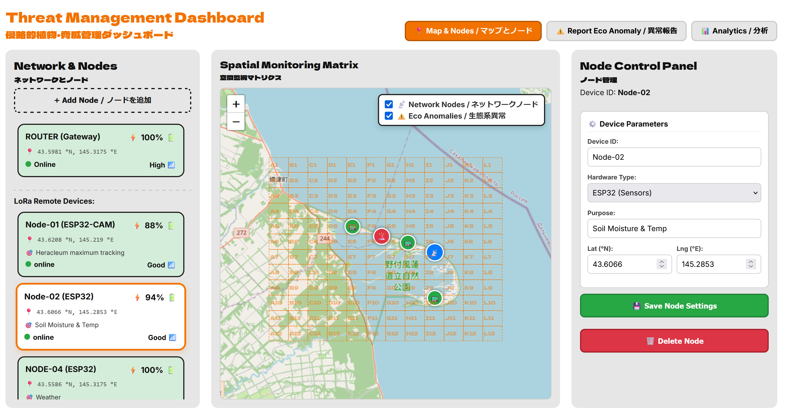
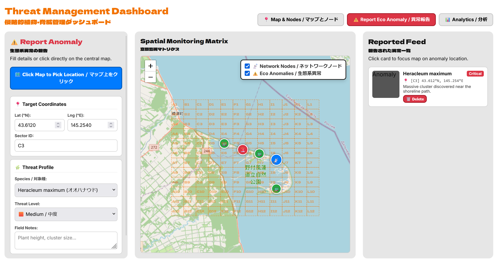
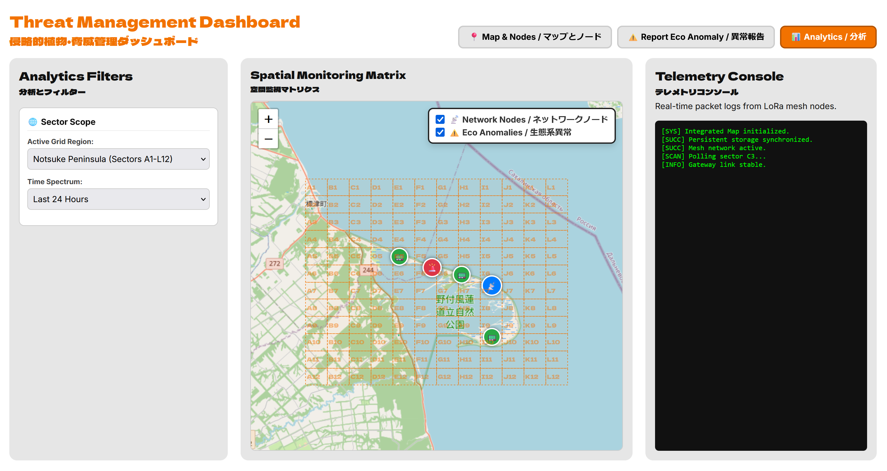

# TerraNode: Dashboard

**A bilingual (EN/JA) web dashboard and REST backend for a 12×12-sector monitoring map: sensor nodes, the LoRa gateway and eco-anomaly reports on one screen.**


🇬🇧 [English](#english) · 🇯🇵 [日本語](#日本語) · 🇷🇺 [Русский](#русский)

⬅️ [Software overview](../README.md) · 🤖 [Telegram bot](../telegram_bot/README.md)

---

## English

### Overview

The dashboard is the desktop side of TerraNode. It shows a map of the study area divided into a 12×12 sector grid, with the LoRa gateway, the sensor nodes and reported eco-anomalies drawn on it. An operator can add, move and delete nodes, report anomalies by clicking on the map, and follow the reports in a feed. Every change is also pushed to Telegram (see the [bot README](../telegram_bot/README.md)).

The interface titles are shown in English and 日本語 side by side. Its backend (`main.py`) is a small FastAPI application with a REST API, and data is kept in JSON files.

> **Status: prototype.** Everything below runs locally. The nodes on the map are **entered by hand**: live data from the physical LoRa gateway is not connected yet (see [Status](#status)).

### Screenshots

**Map & Nodes.** Node list on the left, the map with the sector grid in the centre, the control panel of the selected node on the right.



**Report Eco Anomaly.** Pick a location on the map, choose species and threat level, add notes. Reported anomalies appear in the feed on the right.



**Analytics.** Sector and time filters and a telemetry console (an early prototype, see [Status](#status)).



### Features

**Map & Nodes**
- Interactive map with the dashed 12×12 sector grid (columns **A–L** west to east, rows **1–12** north to south) and layer switches for *Network nodes* and *Eco anomalies*
- Gateway (router) card: position, battery, state, signal quality; the position can be changed or reset to its default
- List of LoRa remote devices with battery level, coordinates, purpose (for example *Heracleum maximum tracking*, *Soil moisture & temp*, *Weather*), state and signal quality
- **Node control panel:** device ID, hardware type (for example ESP32 or ESP32-CAM), purpose, latitude and longitude; save or delete the node

**Report Eco Anomaly**
- Click the map to pick a location, or type the coordinates
- Species, threat level (Low / Medium / Critical) and free-text field notes
- **Reported feed:** each report shows species, severity, sector, coordinates and notes; clicking a card focuses the map on it; reports can be deleted
- Lifecycle: **Reported → Investigating → Resolved** (the status can be changed from the dashboard or from Telegram)

**Analytics**
- Sector scope and time filters
- Telemetry console, intended for real-time packet logs from the LoRa mesh

**Telegram push**
- Every node, gateway or anomaly change made through the API is pushed to the operator's Telegram chat in English and 日本語, with the photo or video when the report has one

### Study area and sector grid

The grid covers the Notsuke Peninsula area of eastern Hokkaido.

| Parameter | Value |
|---|---|
| Latitude range | 43.52°N – 43.68°N |
| Longitude range | 145.12°E – 145.40°E |
| Grid | 12 columns (**A–L**, west → east) × 12 rows (**1–12**, north → south) |
| Cell size | about 0.0133° latitude × 0.0233° longitude |
| Outside the grid | reported as `OUT` |

The same grid is implemented in the backend, the dashboard and the Telegram bot. If you change the study area, change the constants in all three.

### REST API

Interactive documentation is generated automatically at `http://localhost:8000/docs`.

| Method | Path | What it does |
|---|---|---|
| `GET` / `POST` | `/api/nodes` | List nodes / add or update a node |
| `DELETE` | `/api/nodes/{id}` | Delete a node |
| `GET` / `POST` / `DELETE` | `/api/router` | Get / set / reset the gateway position |
| `GET` / `POST` | `/api/anomalies` | List reports / add a report |
| `PUT` / `DELETE` | `/api/anomalies/{id}` | Edit / delete a report |
| `PATCH` | `/api/anomalies/{id}/status` | Change the status (*Reported*, *Investigating*, *Resolved*) |
| `GET` | `/dashboard` | The web interface (`static/index.html`) |

### Status

| Component | Status | Notes |
|---|---|---|
| Map with 12×12 sector grid, layer switches | **Built & tested (locally)** | |
| Node management (add, edit, move, delete) | **Built & tested (locally)** | Nodes are entered manually |
| Gateway position (set, reset) | **Built & tested (locally)** | |
| Anomaly reporting, feed, status changes | **Built & tested (locally)** | Shared with the Telegram bot through the same API |
| Push to Telegram on every change | **Built & tested (locally)** | Needs `BOT_TOKEN` and `ADMIN_CHAT_ID`; otherwise the push is skipped and the dashboard still works |
| Analytics filters and telemetry console | **Prototype** | The console shows interface messages, not real packet logs |
| Live data from the LoRa gateway and physical nodes | **Prototype / next step** | The dashboard shows manually entered nodes, not real sensor state |
| Sensor history and charts | **Conceptual** | |

### Known limitations

- Node battery, state and signal quality are values entered by hand, not measurements.
- The backend stores photos and videos only as **Telegram file IDs**, not as image files, so previews in the feed are limited.
- The API has **no authentication** and allows requests from any origin. It listens on `127.0.0.1` only; do not expose it to the internet.
- Data files and `static/` are found relative to the folder the server is started from.

### Setup and run

**Requirements:** Python 3 and the packages `fastapi`, `uvicorn`, `aiohttp`, `python-dotenv`, `pydantic`.

```bash
cd software/dashboard
pip install fastapi uvicorn aiohttp python-dotenv pydantic
```

Optional, for Telegram push: create a `.env` file (**never commit it**; commit only a `.env.example` with empty values):

```
BOT_TOKEN=your_telegram_bot_token
ADMIN_CHAT_ID=your_telegram_chat_id
```

Start the server from this folder:

```bash
python main.py
```

Then open **http://localhost:8000/dashboard**. To use the Telegram bot, start it afterwards (see the [bot README](../telegram_bot/README.md)). The data files (`nodes.json`, `router.json`, `anomalies.json`) are created automatically on first use; they hold your own data and should stay out of the repository (list them in `.gitignore`).

### Files

| File | Purpose |
|---|---|
| `main.py` | FastAPI backend: REST API, sector calculation, JSON storage, Telegram push, serves the dashboard |
| `static/index.html` | The web interface (map, panels, feed) |
| `nodes.json`, `router.json`, `anomalies.json` | Data files, created at run time |

### Roadmap

1. Show live node state from the LoRa gateway (see [hardware](../../hardware/README.md))
2. Fill the Analytics tab with real telemetry and history
3. Authentication for the API
4. Photo previews in the anomaly feed

### License

MIT License. See [LICENSE](../../LICENSE).

---

## 日本語

### 概要

ダッシュボードは、TerraNodeのデスクトップ側です。調査地を12×12のセクターグリッドに分割した地図の上に、LoRaゲートウェイ、センサーノード、報告された環境異常を表示します。オペレーターは、ノードの追加・移動・削除、地図のクリックによる異常報告、フィードでの報告の確認ができます。すべての変更はTelegramにも通知されます([ボットのREADME](../telegram_bot/README.md)を参照)。

画面の見出しは英語と日本語を併記しています。バックエンド(`main.py`)は、REST APIを備えた小規模なFastAPIアプリケーションで、データはJSONファイルに保存されます。

> **状況:プロトタイプ。** 以下はすべてローカル環境で動作します。地図上のノードは**手動で入力**したものです。物理LoRaゲートウェイからの実データはまだ接続されていません([開発状況](#開発状況)を参照)。

### スクリーンショット

**マップとノード。** 左にノード一覧、中央にセクターグリッド付きの地図、右に選択中ノードの管理パネル。


**異常報告。** 地図上で位置を選び、対象種と脅威レベルを選択し、メモを追加します。報告された異常は右側のフィードに表示されます。


**分析。** セクターと期間のフィルターと、テレメトリコンソール(初期プロトタイプ。[開発状況](#開発状況)を参照)。


### 主な機能

**マップとノード**
- 破線の12×12セクターグリッド(列は西から東へ **A〜L**、行は北から南へ **1〜12**)付きのインタラクティブな地図と、「ネットワークノード」「生態系異常」のレイヤー切替
- ゲートウェイ(ルーター)カード:位置、バッテリー、状態、電波品質。位置は変更したり、既定位置に戻したりできます
- LoRaリモートデバイスの一覧:バッテリー残量、座標、目的(例:*Heracleum maximum tracking*、*Soil moisture & temp*、*Weather*)、状態、電波品質
- **ノード管理パネル:** デバイスID、ハードウェア種別(例:ESP32、ESP32-CAM)、目的、緯度・経度。保存または削除

**異常報告**
- 地図をクリックして位置を選ぶか、座標を入力
- 対象種、脅威レベル(Low / Medium / Critical)、自由記述の現場メモ
- **報告一覧:** 各報告に対象種、脅威レベル、セクター、座標、メモを表示。カードをクリックすると地図がその位置に移動し、報告を削除できます
- ステータスの流れ:**報告済み → 調査中 → 解決済み**(ダッシュボードまたはTelegramから変更可能)

**分析**
- セクター範囲と期間のフィルター
- LoRaメッシュからのリアルタイムのパケットログを表示する想定のテレメトリコンソール

**Telegramへのプッシュ**
- APIを通じたノード・ゲートウェイ・異常の変更はすべて、英語と日本語でオペレーターのTelegramチャットに通知されます。報告に写真や動画があれば、それも添付されます

### 調査地とセクターグリッド

グリッドは北海道東部の野付半島周辺をカバーしています。

| 項目 | 値 |
|---|---|
| 緯度の範囲 | 北緯43.52° 〜 43.68° |
| 経度の範囲 | 東経145.12° 〜 145.40° |
| グリッド | 12列(**A〜L**、西 → 東)× 12行(**1〜12**、北 → 南) |
| セルの大きさ | 緯度 約0.0133° × 経度 約0.0233° |
| グリッド外 | `OUT` と表示 |

同じグリッドがバックエンド、ダッシュボード、Telegramボットに実装されています。調査地を変更する場合は、3か所すべての定数を変更してください。

### REST API

対話型のドキュメントは `http://localhost:8000/docs` に自動生成されます。

| メソッド | パス | 内容 |
|---|---|---|
| `GET` / `POST` | `/api/nodes` | ノード一覧 / ノードの追加・更新 |
| `DELETE` | `/api/nodes/{id}` | ノードの削除 |
| `GET` / `POST` / `DELETE` | `/api/router` | ゲートウェイ位置の取得 / 設定 / リセット |
| `GET` / `POST` | `/api/anomalies` | 報告の一覧 / 追加 |
| `PUT` / `DELETE` | `/api/anomalies/{id}` | 報告の編集 / 削除 |
| `PATCH` | `/api/anomalies/{id}/status` | ステータス変更(*Reported*、*Investigating*、*Resolved*) |
| `GET` | `/dashboard` | Web画面(`static/index.html`) |

### 開発状況

| 要素 | 状況 | 備考 |
|---|---|---|
| 12×12セクターグリッド付きの地図、レイヤー切替 | **実装・ローカルで動作確認済み** | |
| ノード管理(追加・編集・移動・削除) | **実装・ローカルで動作確認済み** | ノードは手動入力 |
| ゲートウェイ位置(設定・リセット) | **実装・ローカルで動作確認済み** | |
| 異常報告、一覧、ステータス変更 | **実装・ローカルで動作確認済み** | 同じAPIを通じてTelegramボットと共有 |
| 変更ごとのTelegramプッシュ | **実装・ローカルで動作確認済み** | `BOT_TOKEN` と `ADMIN_CHAT_ID` が必要。未設定の場合はプッシュをスキップし、ダッシュボードは動作を続ける |
| 分析フィルターとテレメトリコンソール | **プロトタイプ** | コンソールは実際のパケットログではなく、画面のメッセージを表示 |
| LoRaゲートウェイ/物理ノードからの実データ | **プロトタイプ / 次のステップ** | 実際のセンサー状態ではなく、手動入力されたノードを表示 |
| センサー履歴とグラフ | **構想段階** | |

### 既知の制限

- ノードのバッテリー、状態、電波品質は測定値ではなく、手動で入力した値です。
- バックエンドは写真・動画を画像ファイルではなく**TelegramのファイルID**としてのみ保存するため、フィードでのプレビューは限定的です。
- APIには**認証がなく**、すべてのオリジンからのリクエストを許可しています。待ち受けは `127.0.0.1` のみです。インターネットに公開しないでください。
- データファイルと `static/` は、サーバーを起動したフォルダからの相対パスで探されます。

### セットアップと実行

**必要なもの:** Python 3 と、パッケージ `fastapi`、`uvicorn`、`aiohttp`、`python-dotenv`、`pydantic`。

```bash
cd software/dashboard
pip install fastapi uvicorn aiohttp python-dotenv pydantic
```

任意(Telegramプッシュを使う場合):`.env` ファイルを作成します(**絶対にコミットしないこと**。値を空にした `.env.example` だけをコミット):

```
BOT_TOKEN=your_telegram_bot_token
ADMIN_CHAT_ID=your_telegram_chat_id
```

このフォルダでサーバーを起動します:

```bash
python main.py
```

**http://localhost:8000/dashboard** を開いてください。Telegramボットを使う場合は、その後に起動します([ボットのREADME](../telegram_bot/README.md)を参照)。データファイル(`nodes.json`、`router.json`、`anomalies.json`)は初回使用時に自動作成されます。自分のデータが入るため、リポジトリには含めず `.gitignore` に追加してください。

### ファイル

| ファイル | 役割 |
|---|---|
| `main.py` | FastAPIバックエンド:REST API、セクター計算、JSON保存、Telegramプッシュ、ダッシュボードの配信 |
| `static/index.html` | Web画面(地図、パネル、フィード) |
| `nodes.json`、`router.json`、`anomalies.json` | データファイル(実行時に作成) |

### 今後の計画

1. LoRaゲートウェイからの実際のノード状態を表示([ハードウェア](../../hardware/README.md)を参照)
2. 分析タブに実際のテレメトリと履歴を表示
3. APIの認証
4. 異常フィードでの写真プレビュー

### ライセンス

MITライセンス。[LICENSE](../../LICENSE) を参照。

---

## Русский

### Обзор

Дашборд это десктопная часть TerraNode. Он показывает карту района исследования, разбитую на сетку секторов 12×12, с нанесёнными LoRa-шлюзом, сенсорными узлами и зарегистрированными экологическими аномалиями. Оператор может добавлять, переносить и удалять узлы, отправлять отчёты об аномалиях кликом по карте и следить за ними в ленте. Каждое изменение также приходит в Telegram (см. [README бота](../telegram_bot/README.md)).

Заголовки интерфейса выводятся сразу на английском и японском. Бэкенд (`main.py`) это небольшое приложение на FastAPI с REST API, данные хранятся в JSON-файлах.

> **Статус: прототип.** Всё описанное ниже работает локально. Узлы на карте **введены вручную**: живые данные с физического LoRa-шлюза пока не подключены (см. [Статус](#статус)).

### Скриншоты

**Карта и узлы.** Слева список узлов, в центре карта с сеткой секторов, справа панель управления выбранным узлом.


**Отчёт об аномалии.** Выбери место на карте, вид и уровень угрозы, добавь заметки. Зарегистрированные аномалии появляются в ленте справа.


**Аналитика.** Фильтры по сектору и времени и консоль телеметрии (ранний прототип, см. [Статус](#статус)).


### Возможности

**Карта и узлы**
- Интерактивная карта с пунктирной сеткой секторов 12×12 (столбцы **A–L** с запада на восток, строки **1–12** с севера на юг) и переключателями слоёв «Узлы сети» и «Экологические аномалии»
- Карточка шлюза (роутера): положение, заряд, состояние, качество сигнала; положение можно изменить или сбросить на значение по умолчанию
- Список удалённых LoRa-устройств с зарядом, координатами, назначением (например, *Heracleum maximum tracking*, *Soil moisture & temp*, *Weather*), состоянием и качеством сигнала
- **Панель управления узлом:** ID устройства, тип оборудования (например, ESP32 или ESP32-CAM), назначение, широта и долгота; сохранить или удалить узел

**Отчёт об аномалии**
- Кликни по карте, чтобы выбрать место, или введи координаты
- Вид, уровень угрозы (Low / Medium / Critical) и заметки в свободной форме
- **Лента отчётов:** у каждого отчёта вид, уровень угрозы, сектор, координаты и заметки; клик по карточке наводит карту на место, отчёт можно удалить
- Жизненный цикл: **Сообщено → Расследуется → Решено** (статус меняется из дашборда или из Telegram)

**Аналитика**
- Фильтры по сектору и времени
- Консоль телеметрии, предназначенная для журналов пакетов LoRa-меша в реальном времени

**Push в Telegram**
- Каждое изменение узла, шлюза или аномалии через API уходит в Telegram-чат оператора на английском и японском, а если у отчёта есть фото или видео, то и с ним

### Район исследования и сетка секторов

Сетка накрывает район полуострова Ноцукэ на востоке Хоккайдо.

| Параметр | Значение |
|---|---|
| Диапазон широт | 43.52° с. ш. – 43.68° с. ш. |
| Диапазон долгот | 145.12° в. д. – 145.40° в. д. |
| Сетка | 12 столбцов (**A–L**, запад → восток) × 12 строк (**1–12**, север → юг) |
| Размер ячейки | около 0.0133° по широте × 0.0233° по долготе |
| За пределами сетки | выводится как `OUT` |

Одна и та же сетка реализована в бэкенде, дашборде и Telegram-боте. Если меняешь район исследования, поменяй константы во всех трёх местах.

### REST API

Интерактивная документация создаётся автоматически по адресу `http://localhost:8000/docs`.

| Метод | Путь | Что делает |
|---|---|---|
| `GET` / `POST` | `/api/nodes` | Список узлов / добавление или обновление узла |
| `DELETE` | `/api/nodes/{id}` | Удаление узла |
| `GET` / `POST` / `DELETE` | `/api/router` | Получить / задать / сбросить положение шлюза |
| `GET` / `POST` | `/api/anomalies` | Список отчётов / добавление отчёта |
| `PUT` / `DELETE` | `/api/anomalies/{id}` | Правка / удаление отчёта |
| `PATCH` | `/api/anomalies/{id}/status` | Смена статуса (*Reported*, *Investigating*, *Resolved*) |
| `GET` | `/dashboard` | Веб-интерфейс (`static/index.html`) |

### Статус

| Компонент | Статус | Примечания |
|---|---|---|
| Карта с сеткой секторов 12×12, переключатели слоёв | **Сделано, проверено локально** | |
| Управление узлами (добавление, правка, перенос, удаление) | **Сделано, проверено локально** | Узлы вводятся вручную |
| Положение шлюза (задать, сбросить) | **Сделано, проверено локально** | |
| Отчёты об аномалиях, лента, смена статусов | **Сделано, проверено локально** | Общие с Telegram-ботом через тот же API |
| Push в Telegram при каждом изменении | **Сделано, проверено локально** | Нужны `BOT_TOKEN` и `ADMIN_CHAT_ID`; без них push пропускается, а дашборд продолжает работать |
| Фильтры аналитики и консоль телеметрии | **Прототип** | Консоль показывает сообщения интерфейса, а не реальные журналы пакетов |
| Живые данные с LoRa-шлюза и физических узлов | **Прототип / следующий шаг** | Дашборд показывает вручную введённые узлы, а не реальное состояние датчиков |
| История показаний и графики | **Концепция** | |

### Известные ограничения

- Заряд, состояние и качество сигнала узлов это значения, введённые вручную, а не измерения.
- Бэкенд хранит фото и видео только как **file ID Telegram**, а не как файлы изображений, поэтому предпросмотр в ленте ограничен.
- У API **нет авторизации**, и он принимает запросы с любого источника. Он слушает только `127.0.0.1`; не выставляй его в интернет.
- Файлы данных и `static/` ищутся относительно папки, из которой запущен сервер.

### Установка и запуск

**Требования:** Python 3 и пакеты `fastapi`, `uvicorn`, `aiohttp`, `python-dotenv`, `pydantic`.

```bash
cd software/dashboard
pip install fastapi uvicorn aiohttp python-dotenv pydantic
```

По желанию, для push в Telegram: создайте файл `.env` (**никогда не коммить его**):

```
BOT_TOKEN=your_telegram_bot_token
ADMIN_CHAT_ID=your_telegram_chat_id
```

Запустите сервер из этой папки:

```bash
python main.py
```

Затем откройте **http://localhost:8000/dashboard**. Чтобы пользоваться Telegram-ботом, запустите его после этого (см. [README бота](../telegram_bot/README.md)). Файлы данных (`nodes.json`, `router.json`, `anomalies.json`) создаются автоматически при первом использовании; в них лежат ваши собственные данные, поэтому держите их вне репозитория (добавь в `.gitignore`).

### Файлы

| Файл | Назначение |
|---|---|
| `main.py` | Бэкенд на FastAPI: REST API, расчёт секторов, JSON-хранилище, push в Telegram, отдача дашборда |
| `static/index.html` | Веб-интерфейс (карта, панели, лента) |
| `nodes.json`, `router.json`, `anomalies.json` | Файлы данных, создаются при работе |

### Планы

1. Показывать реальное состояние узлов с LoRa-шлюза (см. [железо](../../hardware/README.md))
2. Наполнить вкладку «Аналитика» реальной телеметрией и историей
3. Авторизация для API
4. Предпросмотр фото в ленте аномалий

### Лицензия

MIT License. См. [LICENSE](../../LICENSE).
