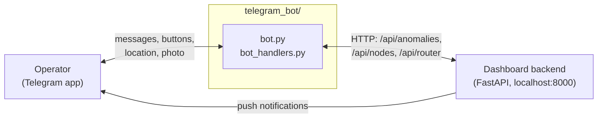
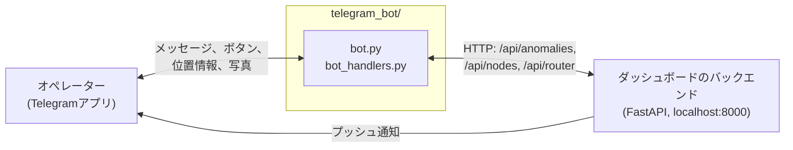
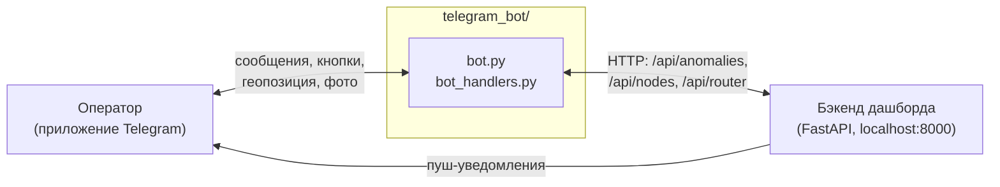

# TerraNode: Telegram Bot

**A bilingual (EN/JA) Telegram bot for field operators: report eco-anomalies, check node status and manage reports from a phone.**


🇬🇧 [English](#english) · 🇯🇵 [日本語](#日本語) · 🇷🇺 [Русский](#русский)

⬅️ [Software overview](../README.md) · 🗺️ [Dashboard](../dashboard/README.md)

---

## English

### Overview

The bot is the phone-side interface of TerraNode. An operator in the field can file an eco-anomaly report (with GPS location and a photo or video), review and update earlier reports, and check the state of the nodes and the gateway. It talks to the [dashboard backend](../dashboard/README.md) over HTTP, so anything done in the bot appears on the dashboard, and changes made on the dashboard are pushed back to Telegram.

> **Status: prototype.** Anomaly reporting and report management work end to end. Some menu items only acknowledge the input and do not store it yet (see [Status](#status)).

### What the bot can do

**Commands**

| Command | What it does |
|---|---|
| `/start` | Opens the main menu (also resets any unfinished form) |
| `/status` | Shows the gateway and all nodes from the dashboard: state, battery, purpose, sector, coordinates |
| `/alert_test` | Pick a node and send a test alert with a dashboard link and an *Acknowledge* button |
| `/myreports` | Lists the last 5 anomaly reports, newest first |
| `/cancel` | Cancels the current form |

**Main menu buttons**

- **Report eco-anomaly.** A guided form: species (*Heracleum*, invasive weed, other) → severity (Low / Medium / Critical) → location (share your Telegram location) → notes → optional photo or video → review screen with *Confirm* and *Edit notes*. The finished report is sent to the backend.
- **My reports.** For each report: mark it *Investigating* or *Resolved*, correct its location, or delete it (with a confirmation step). Lifecycle: **Reported → Investigating → Resolved**.
- **Submit sample.** Enter a quadrat and a count.
- **Send GPS location** and **Check-in.**
- **Language switch** between English and 日本語.

### How it fits in



- The bot reads nodes and the gateway from `/api/nodes` and `/api/router`, and reads, creates, updates and deletes anomaly reports through `/api/anomalies`. It does **not** touch the JSON files directly; only the backend does.
- Notifications about dashboard changes (a new node, a moved gateway, a new anomaly) are sent by the **backend** straight to Telegram, so they arrive even while the bot process is not running.
- The bot therefore needs the backend to be running to show data.
- The sector grid (12×12) in the bot is a copy of the one in the backend and dashboard; keep the constants identical if you change the study area.

### Status

| Feature | Status | Notes |
|---|---|---|
| Anomaly report (species, severity, GPS, notes, photo/video, confirmation) | **Built & tested (locally)** | Sent to the backend, which also pushes it to Telegram |
| My reports: status change, edit location, delete | **Built & tested (locally)** | Changes are written through the backend API |
| `/status` network overview | **Built & tested (locally)** | Node data comes from the dashboard; some fields (system health, radio band) are fixed text, not measurements |
| `/alert_test` test alert | **Built & tested (locally)** | A manual test; real node alarms do not exist yet |
| EN / 日本語 interface | **Built & tested (locally)** | Menus and forms follow the chosen language; `/status` and alerts show both languages |
| Submit sample, Send GPS, Check-in | **Prototype** | The bot acknowledges the input but does not store it yet |
| Alerts from real sensor nodes | **Conceptual** | Waiting for the live gateway → backend link (see [hardware](../../hardware/README.md)) |
| LINE version | **Conceptual** | Planned for use in Japan |

### Known limitations

- **One authorised user.** Access is limited to the single chat ID in `ADMIN_CHAT_ID`; everyone else is denied.
- The chosen interface language is kept in memory and resets when the bot restarts.
- The backend address (`http://localhost:8000`) is written in the code, so the bot and the backend must run on the same machine unless you change it.
- The backend API has no authentication yet; do not expose it to the internet.

### Setup

**Requirements:** Python 3 and the packages `aiogram` (3.x), `aiohttp`, `python-dotenv`.

```bash
pip install aiogram aiohttp python-dotenv
```

1. Create a bot with [@BotFather](https://t.me/BotFather) and copy its token.
2. Create a `.env` file (**never commit it**; commit only a `.env.example` with empty values):
   ```
   BOT_TOKEN=your_telegram_bot_token
   ADMIN_CHAT_ID=
   ```
3. Start the backend first (see the [dashboard README](../dashboard/README.md)), then the bot:
   ```bash
   python bot.py
   ```
4. Send `/start` to the bot. If `ADMIN_CHAT_ID` is empty or wrong, the bot replies with the exact line to put into `.env`. Paste it and restart the bot.

`.env` is searched from the script's folder upward, so it can sit next to `bot.py` or in a parent folder. The backend reads the same `BOT_TOKEN` and `ADMIN_CHAT_ID`.

### Files

| File | Purpose |
|---|---|
| `bot.py` | Entry point: `/status`, `/alert_test`, alert acknowledgement, command menu, polling |
| `bot_handlers.py` | Menu, forms (anomaly, sample, GPS), `/myreports`, language texts (EN/JA) |

### Roadmap

1. Store submitted samples, GPS updates and check-ins in the backend
2. Real alerts from sensor nodes once the gateway is connected
3. Several authorised operators instead of one chat ID
4. LINE (Messaging API) version for use in Japan

### License

MIT License. See [LICENSE](../../LICENSE).

---

## 日本語

### 概要

このボットは、TerraNodeのスマートフォン側インターフェースです。現場のオペレーターは、GPS位置と写真・動画付きで環境異常を報告し、過去の報告を確認・更新し、ノードやゲートウェイの状態を確認できます。[ダッシュボードのバックエンド](../dashboard/README.md)とHTTPで通信するため、ボットでの操作はダッシュボードに反映され、ダッシュボード側の変更はTelegramへ通知されます。

> **状況:プロトタイプ。** 異常報告と報告の管理は、ボットからバックエンドまで一通り動作します。一部のメニューは入力に応答するだけで、まだ保存しません([開発状況](#開発状況)を参照)。

### ボットでできること

**コマンド**

| コマンド | 内容 |
|---|---|
| `/start` | メインメニューを開く(未完了のフォームもリセット) |
| `/status` | ダッシュボード上のゲートウェイと全ノードの状態、バッテリー、目的、セクター、座標を表示 |
| `/alert_test` | ノードを選び、ダッシュボードへのリンクと「確認」ボタン付きのテスト通知を送信 |
| `/myreports` | 直近5件の異常報告を新しい順に表示 |
| `/cancel` | 現在のフォームをキャンセル |

**メインメニューのボタン**

- **生態系異常の報告。** 案内に沿ったフォーム:対象種(*Heracleum*、外来雑草、その他) → 脅威レベル(Low / Medium / Critical) → 位置(Telegramの位置情報を共有) → メモ → 写真または動画(任意) → 確認画面(「確定」「メモを編集」)。完成した報告はバックエンドへ送信されます。
- **過去の報告。** 各報告について、「調査中」「解決済み」への変更、位置の修正、削除(確認ステップ付き)ができます。ステータスの流れ:**報告済み → 調査中 → 解決済み**。
- **サンプル提出。** コドラートと個数を入力します。
- **GPS位置の送信**と**チェックイン**。
- **言語切替**(English / 日本語)。

### 全体の仕組み



- ボットは `/api/nodes` と `/api/router` でノードとゲートウェイを取得し、`/api/anomalies` で異常報告の取得・作成・更新・削除を行います。JSONファイルには**直接触れません**。触れるのはバックエンドだけです。
- ダッシュボードでの変更(ノード追加、ゲートウェイ移動、新しい異常など)の通知は、**バックエンド**から直接Telegramへ送られるため、ボットのプロセスが動いていなくても届きます。
- そのため、データを表示するにはバックエンドが起動している必要があります。
- ボット内の12×12セクターグリッドは、バックエンドとダッシュボードのものの複製です。調査地を変更する場合は、定数を同じ値に揃えてください。

### 開発状況

| 機能 | 状況 | 備考 |
|---|---|---|
| 異常報告(対象種、脅威レベル、GPS、メモ、写真/動画、確認) | **実装・ローカルで動作確認済み** | バックエンドへ送信され、バックエンドがTelegramへも通知 |
| 過去の報告:ステータス変更、位置編集、削除 | **実装・ローカルで動作確認済み** | 変更はバックエンドAPI経由で保存 |
| `/status` ネットワーク概要 | **実装・ローカルで動作確認済み** | ノード情報はダッシュボード由来。一部の項目(システム状態、使用帯域)は測定値ではなく固定表示 |
| `/alert_test` テスト通知 | **実装・ローカルで動作確認済み** | 手動テスト。実際のノードからの警報はまだありません |
| English / 日本語 の表示 | **実装・ローカルで動作確認済み** | メニューとフォームは選択した言語で表示。`/status` と通知は両言語を併記 |
| サンプル提出、GPS送信、チェックイン | **プロトタイプ** | 入力には応答するが、まだ保存しない |
| 実センサーノードからの警報 | **構想段階** | ゲートウェイ → バックエンドの実データ連携待ち([ハードウェア](../../hardware/README.md)) |
| LINE版 | **構想段階** | 日本での利用を想定 |

### 既知の制限

- **認可ユーザーは1人のみ。** `ADMIN_CHAT_ID` に設定した1つのチャットIDだけが利用でき、他は拒否されます。
- 選択した表示言語はメモリ上に保持され、ボットを再起動するとリセットされます。
- バックエンドのアドレス(`http://localhost:8000`)はコードに直書きされているため、変更しない限り、ボットとバックエンドは同じマシンで動かす必要があります。
- バックエンドAPIにはまだ認証がありません。インターネットに公開しないでください。

### セットアップ

**必要なもの:** Python 3 と、パッケージ `aiogram`(3.x)、`aiohttp`、`python-dotenv`。

```bash
pip install aiogram aiohttp python-dotenv
```

1. [@BotFather](https://t.me/BotFather) でボットを作成し、トークンをコピーします。
2. `.env` ファイルを作成します(**絶対にコミットしないこと**。値を空にした `.env.example` だけをコミット):
   ```
   BOT_TOKEN=your_telegram_bot_token
   ADMIN_CHAT_ID=
   ```
3. 先にバックエンドを起動し([ダッシュボードのREADME](../dashboard/README.md)を参照)、次にボットを起動します:
   ```bash
   python bot.py
   ```
4. ボットに `/start` を送ります。`ADMIN_CHAT_ID` が空または誤っている場合、`.env` に書くべき行がそのまま返信されます。それを貼り付けて、ボットを再起動してください。

`.env` はスクリプトのフォルダから上位へ向かって検索されるため、`bot.py` と同じ場所でも親フォルダでも構いません。バックエンドも同じ `BOT_TOKEN` と `ADMIN_CHAT_ID` を読み込みます。

### ファイル

| ファイル | 役割 |
|---|---|
| `bot.py` | エントリーポイント:`/status`、`/alert_test`、通知の確認、コマンドメニュー、ポーリング |
| `bot_handlers.py` | メニュー、フォーム(異常・サンプル・GPS)、`/myreports`、言語テキスト(英/日) |

### 今後の計画

1. 提出されたサンプル、GPS更新、チェックインをバックエンドに保存
2. ゲートウェイ接続後、実センサーノードからの警報
3. 1つのチャットIDではなく、複数のオペレーターを認可
4. 日本での利用に向けたLINE(Messaging API)版

### ライセンス

MITライセンス。[LICENSE](../../LICENSE) を参照。

---

## Русский

### Обзор

Бот это телефонный интерфейс TerraNode. Оператор в поле может отправить отчёт об экологической аномалии (с GPS-положением и фото или видео), просмотреть и обновить прежние отчёты и проверить состояние узлов и шлюза. Бот общается с [бэкендом дашборда](../dashboard/README.md) по HTTP, поэтому всё, что сделано в боте, появляется на дашборде, а изменения на дашборде приходят обратно в Telegram.

> **Статус: прототип.** Отчёты об аномалиях и управление ими работают от бота до бэкенда. Некоторые пункты меню пока только подтверждают ввод и ничего не сохраняют (см. [Статус](#статус)).

### Что умеет бот

**Команды**

| Команда | Что делает |
|---|---|
| `/start` | Открывает главное меню (заодно сбрасывает незавершённую форму) |
| `/status` | Показывает шлюз и все узлы с дашборда: состояние, заряд, назначение, сектор, координаты |
| `/alert_test` | Выбери узел и отправь тестовое оповещение со ссылкой на дашборд и кнопкой «Подтвердить» |
| `/myreports` | Показывает последние 5 отчётов об аномалиях, сначала новые |
| `/cancel` | Отменяет текущую форму |

**Кнопки главного меню**

- **Сообщить об аномалии.** Пошаговая форма: вид (*Heracleum*, инвазивный сорняк, другое) → уровень угрозы (Low / Medium / Critical) → положение (поделиться геопозицией Telegram) → заметки → необязательное фото или видео → экран проверки с кнопками «Подтвердить» и «Изменить заметки». Готовый отчёт уходит на бэкенд.
- **Мои отчёты.** Для каждого отчёта можно поставить статус «Расследуется» или «Решено», исправить положение или удалить (с подтверждением). Жизненный цикл: **Сообщено → Расследуется → Решено**.
- **Отправить образец.** Ввод квадрата и количества.
- **Отправить GPS-положение** и **Отметиться.**
- **Переключение языка** English / 日本語.

### Как это встроено в систему



- Бот получает узлы и шлюз через `/api/nodes` и `/api/router`, а отчёты об аномалиях читает, создаёт, обновляет и удаляет через `/api/anomalies`. С JSON-файлами он **напрямую не работает**, их трогает только бэкенд.
- Уведомления об изменениях на дашборде (новый узел, перенос шлюза, новая аномалия) отправляет **бэкенд** прямо в Telegram, поэтому они приходят, даже если процесс бота не запущен.
- Чтобы бот показывал данные, бэкенд должен быть запущен.
- Сетка секторов 12×12 в боте это копия сетки из бэкенда и дашборда; если меняешь район исследования, держи константы одинаковыми.

### Статус

| Функция | Статус | Примечания |
|---|---|---|
| Отчёт об аномалии (вид, угроза, GPS, заметки, фото/видео, подтверждение) | **Сделано, проверено локально** | Уходит на бэкенд, который дополнительно шлёт его в Telegram |
| Мои отчёты: смена статуса, правка положения, удаление | **Сделано, проверено локально** | Изменения записываются через API бэкенда |
| Обзор сети `/status` | **Сделано, проверено локально** | Данные узлов берутся с дашборда; часть полей (состояние системы, радиодиапазон) это фиксированный текст, а не измерения |
| Тестовое оповещение `/alert_test` | **Сделано, проверено локально** | Ручной тест; реальных тревог от узлов пока нет |
| Интерфейс EN / 日本語 | **Сделано, проверено локально** | Меню и формы идут на выбранном языке; `/status` и оповещения показывают оба языка |
| Отправка образца, GPS, отметка | **Прототип** | Бот подтверждает ввод, но пока не сохраняет его |
| Тревоги от реальных датчиков | **Концепция** | Ждут живой связи шлюз → бэкенд (см. [железо](../../hardware/README.md)) |
| LINE-версия | **Концепция** | Запланирована для работы в Японии |

### Известные ограничения

- **Один авторизованный пользователь.** Доступ есть только у одного chat ID из `ADMIN_CHAT_ID`, остальным отказ.
- Выбранный язык интерфейса хранится в памяти и сбрасывается при перезапуске бота.
- Адрес бэкенда (`http://localhost:8000`) прописан в коде, поэтому бот и бэкенд должны работать на одной машине, пока адрес не изменён.
- У API бэкенда пока нет авторизации, не выставляй его в интернет.

### Установка

**Требования:** Python 3 и пакеты `aiogram` (3.x), `aiohttp`, `python-dotenv`.

```bash
pip install aiogram aiohttp python-dotenv
```

1. Создайте бота через [@BotFather](https://t.me/BotFather) и скопируй токен.
2. Создайте файл `.env` (**никогда не коммить его**):
   ```
   BOT_TOKEN=your_telegram_bot_token
   ADMIN_CHAT_ID=
   ```
3. Сначала запустите бэкенд (см. [README дашборда](../dashboard/README.md)), затем бота:
   ```bash
   python bot.py
   ```
4. Отправьте боту `/start`. Если `ADMIN_CHAT_ID` пуст или неверен, бот ответит точной строкой, которую нужно вставить в `.env`. Вставьте её и перезапусти бота.

`.env` ищется от папки скрипта вверх, поэтому он может лежать рядом с `bot.py` или в родительской папке. Бэкенд читает те же `BOT_TOKEN` и `ADMIN_CHAT_ID`.

### Файлы

| Файл | Назначение |
|---|---|
| `bot.py` | Точка входа: `/status`, `/alert_test`, подтверждение оповещений, меню команд, polling |
| `bot_handlers.py` | Меню, формы (аномалия, образец, GPS), `/myreports`, тексты на двух языках (EN/JA) |

### Планы

1. Сохранять на бэкенде отправленные образцы, GPS-обновления и отметки
2. Реальные тревоги от датчиков после подключения шлюза
3. Несколько авторизованных операторов вместо одного chat ID
4. Версия для LINE (Messaging API) для работы в Японии

### Лицензия

MIT License. См. [LICENSE](../../LICENSE).
